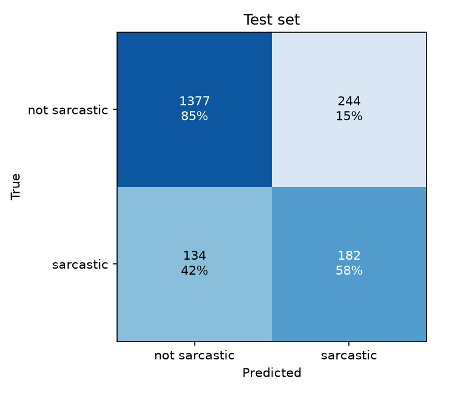

# Arabic Sarcasm Detection

[](https://github.com/eslammohibrahim/arabic-sarcasm-detection/actions/workflows/tests.yml)

In my [sentiment project](https://github.com/eslammohibrahim/arabic-sentiment-analysis) I had to change one test sentence because the model read "يا سلام على الخدمة" as praise. Any Egyptian knows it isn't. So this time I tried to teach a model the sarcasm part directly.

It catches 58% of the sarcastic tweets in the test set (182 of 316) with an F1 of 0.49 on the sarcastic class. That's not great, and I think it's an honest number for sarcasm with a bag-of-words model. A "model" that never says sarcastic gets 83.7% accuracy here, more than mine (80.5%), because only 16% of the tweets are sarcastic. So I compared models on F1 for the sarcastic class, not accuracy.

```text
$ python src/predict.py "يا سلام على الخدمة، استنينا ساعتين" "يا سلام على الخدمة، استنينا ساعتين 😂"
not sarcastic -0.68  | يا سلام على الخدمة، استنينا ساعتين
sarcastic     +0.15  | يا سلام على الخدمة، استنينا ساعتين 😂
```

Same sentence, one emoji. That's pretty much the whole story of this model: it leans a lot on emojis and "!!!" and still misses a lot of plain-text sarcasm. The number is the distance from the decision boundary, so +0.15 means barely.

## Data

[ArSarcasm](https://huggingface.co/datasets/iabufarha/ar_sarcasm) (Abu Farha and Magdy, 2020), MIT license. 10,547 Arabic tweets, each labeled sarcastic or not, plus dialect and sentiment. Not in the repo; `src/data.py` downloads it on the first run.

A few things I noticed before training:

- Most tweets are about politics and football, and a lot of them are rude. So the model learned sarcasm about governments and Messi, not about restaurants or exams. That explains some of the misses below.
- 88% of the sarcastic tweets are labeled negative sentiment. Sarcasm here is mostly a complaint wearing a nice word.
- Egyptian tweets are 33.5% sarcastic, MSA tweets only 8.9%.

I kept the official train / test split, took 10% of train for validation, and dropped empty tweets, duplicates, tweets marked both ways, and 151 test tweets that also show up in train (retweets mostly). That leaves 7,276 / 809 / 1,937.

## Text, two ways

The normalization from my earlier projects removes tashkeel, unifies alef and ya, cuts stretched letters, and throws away everything that isn't a letter or digit. For sarcasm that last step felt wrong, since a lot of it is in 😂, 🙄, "!!!" and "حلووووو". So every model was trained on two versions of the text:

1. **words only**: the old normalization
2. **words + emojis/punctuation**: the same, plus tokens like `emo1f602` (😂), `xmanyexclaim`, `xstretched`, `xlaugh`

## Models

TF-IDF on words (1-2 grams) or characters (2-5 grams). The linear models use balanced class weights, otherwise they mostly learn to say "not sarcastic". Each one got a small search over its main setting on validation.

Validation F1 on the sarcastic class:

| Model | Words only | + emojis/punctuation |
|---|---|---|
| Always "not sarcastic" | 0.000 | 0.000 |
| Naive Bayes (words) | 0.450 | 0.477 |
| Logistic Regression (words) | 0.453 | 0.466 |
| Linear SVM (characters) | 0.508 | **0.509** |
| Linear SVM (words + characters) | 0.502 | 0.505 |

The emoji tokens help every model a bit, the most for Naive Bayes. For the best model the difference is tiny, so I wouldn't make a big claim about it. I picked Linear SVM on characters with emojis (C = 0.3), retrained it on train + validation, and ran it on test once.

## Results (test, 1,937 tweets)

| | Accuracy | Precision | Recall | F1 (sarcastic) |
|---|---|---|---|---|
| Always "not sarcastic" | 83.7% | - | 0% | 0.000 |
| Linear SVM (chars + emojis) | 80.5% | 42.7% | 57.6% | **0.491** |



So when it says sarcastic, it's right less than half the time (244 false alarms), and it finds a bit more than half of the real sarcasm.

Recall by dialect:

| Dialect | Sarcasm caught |
|---|---|
| Egyptian | 68.7% |
| Levantine | 57.7% |
| MSA | 46.2% |
| Gulf | 45.5% |

Egyptian sarcasm is the easiest for it. My guess is that there's more of it in the data and it has more "ههههه" and emojis.

## Where it fails

```text
not sarcastic -0.36  | الأسعار رخيصة جدا السنة دي ما شاء الله
not sarcastic -0.40  | شكرا يا حكومة على الهدية الجميلة دي
```

Both are obviously sarcastic to a person and both have no emoji. To get these you need to know that prices aren't cheap this year, and a TF-IDF model has no idea about that. A pretrained Arabic model (AraBERT or MARBERT) should do better here, so a fine-tuned BERT is the next thing I'd try.

## Run it

```bash
pip install -r requirements.txt
python src/train.py      # downloads the data, compares the models, saves models/ and reports/
python src/predict.py    # example sentences, or pass your own
pytest -q
```

## Files

```
src/preprocess.py   text normalization, and the version that keeps emojis and punctuation
src/data.py         download, clean, split
src/train.py        compare models, pick by validation F1, test once
src/predict.py      try sentences
reports/            results.json and the confusion matrix
```
